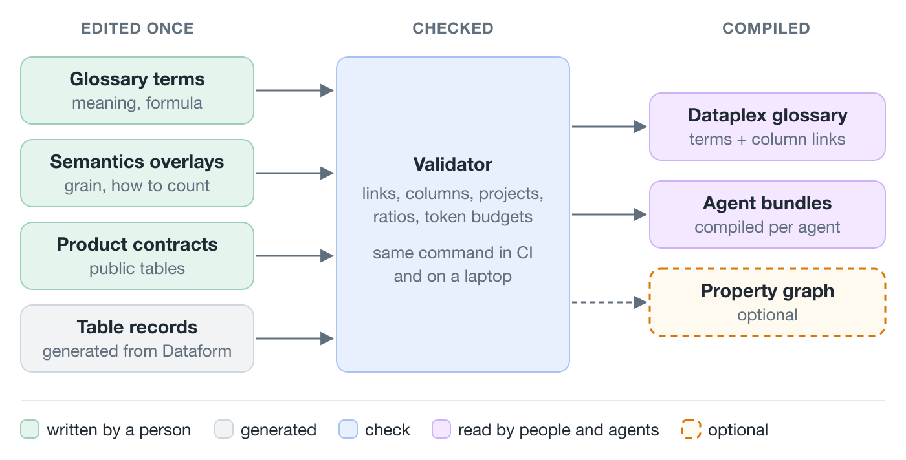

# Visual style

Calm, light, no decoration. Every colour means one kind of thing, the same in every article, so a reader learns the legend once. The style comes from the author's internal overview pages; [visuals/example-one-owner.svg](visuals/example-one-owner.svg) shows it applied to this repository.



## Colour means role

| Role | Fill | Stroke | In this repository |
| :-- | :-- | :-- | :-- |
| written by a person | `#e6f4ee` | `#9ccfb8` | glossary terms, overlays, product contracts, bundle specs, `.sqlx` |
| generated | `#f1f3f5` | `#cfd6dd` | table records, `index.md`, everything in `dist/` |
| check | `#e8f0fe` | `#a9c1f5` | validator, CI gates |
| read by people and agents | `#f3e8ff` | `#cdb3f5` | Dataplex, agents, BI tools, BigQuery Studio |
| optional or planned | `#fffaf0` | `#d97706`, dashed | steps that are not built or not required |
| problem, the "before" side | `#fdecea` | `#a12622` | what goes wrong without the approach |

Base colours: text `#1f2933`, secondary text and arrows `#616e7c`, lines `#e4e7eb`, accent `#0b6e4f`, background white. To mark what changed in a before/after, add a violet outline (`#7c3aed`).

## Diagrams

- **Draw at reading size.** Medium shows body images about 700 px wide, so the SVG `viewBox` is 700 wide and the font sizes in it are the sizes the reader sees. Export at 2× (1400 px).
- **Text:** box titles 14–15 px bold, everything else at least 13 px. Smaller text disappears on a phone.
- **At most about eight boxes per image.** More than that means two images.
- **Boxes:** 9 px corner radius, a title and at most one or two short lines under it. Arrows `#616e7c`, 1.5 px; a dashed arrow means optional or broken.
- **Before and after side by side,** split by a light line, labelled BEFORE in red and AFTER in green.
- **No title inside the image.** The Medium caption under the image says what it shows.
- **A legend in the first diagram of every article.** Readers arrive at any article first.
- **White background, never transparent.** Medium's apps have a dark mode, and a transparent PNG turns unreadable in it.
- **No shadows, gradients, icon sets, stock photos or AI illustrations.** A real screenshot (a merge request diff, the Obsidian graph, a column in BigQuery Studio showing its term) beats any illustration and proves the thing exists.
- **The first image is the preview** in Medium feeds and on social media. Make it the core diagram of the article, readable as a thumbnail.

## Tables

Medium has no tables. In this order:
1. Rewrite as a short list, if the table is small.
2. Render it as an image in this palette, at most 4 columns and 8 rows.
3. Link to the table in the repository, if it is reference material.

## Files and export

- The source of every diagram is an SVG in the article folder, `NN-slug/img/<name>.svg`, committed next to the text. The PNG is exported from it and committed too, so it can be uploaded to Medium:

  ```bash
  rsvg-convert -z 2 -o img/<name>.png img/<name>.svg
  ```

- Start a new diagram by copying [visuals/example-one-owner.svg](visuals/example-one-owner.svg): the palette, sizes and arrow marker are already set.
- Fonts in the SVG: `'Helvetica Neue', Helvetica, Arial, sans-serif`. `rsvg-convert` does not resolve `-apple-system`.
- Look at the exported PNG before using it. Text that overflows a box only shows there.
- **Czech version:** a diagram with English text gets a Czech twin, `<name>.cs.svg`. Screenshots stay as they are.
